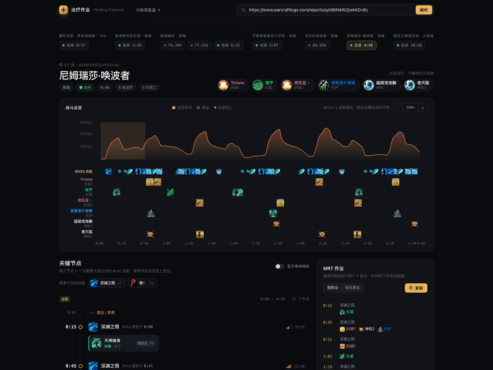
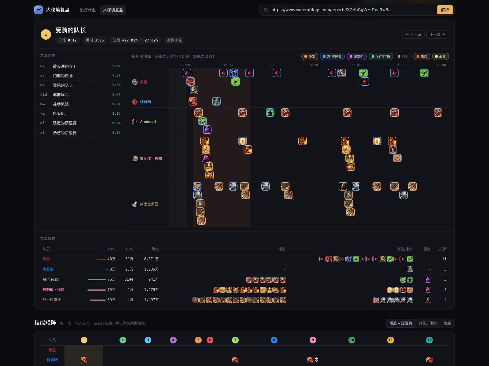

# 治疗作业

**中文** | [English](README.en.md)

把 Warcraft Logs 的战斗记录整理成一张治疗大招时间轴，也可以把一场大秘境拆成每一波来复盘。

不用安装 Python，不用注册账号，日志只在本机分析。

## 下载

| 系统 | 下载 | 怎么打开 |
| --- | --- | --- |
| Windows 10/11 | [WCL-Analyzer.exe](https://github.com/LiQunXia/wcl-analyzer/releases/latest/download/WCL-Analyzer.exe) | 双击运行 |
| macOS（Apple 芯片） | [Releases 里的 `WCL-Analyzer-macos-arm64.zip`](https://github.com/LiQunXia/wcl-analyzer/releases/latest) | 解压后，在终端运行 `./WCL-Analyzer` |
| macOS（Intel） | [Releases 里的 `WCL-Analyzer-macos-x86_64.zip`](https://github.com/LiQunXia/wcl-analyzer/releases/latest) | 同上 |

不知道 Mac 是哪种芯片？点左上角苹果菜单 →「关于本机」，看「芯片」一栏。Apple M 系列选 `arm64`，Intel 选 `x86_64`。

Releases 里暂时没有 macOS 包时，可以看文末的[从源码运行](#从源码运行可选)。

## 三步开始

1. **打开程序**：Windows 双击 `WCL-Analyzer.exe`；macOS 解压后在终端运行 `./WCL-Analyzer`。
2. **等浏览器自动打开**：地址是 <http://127.0.0.1:8000>。黑色窗口/终端窗口不要关，它就是程序的开关，关掉就退出。
3. **粘贴日志链接**：把 Warcraft Logs 的报告链接粘进输入框，点「解析」，再选一场战斗。

想先试试？可以用这份公开日志（就是下面截图里的一场）：<https://cn.warcraftlogs.com/reports/qA96N4W2jwkKDv8c?fight=53>

Warcraft Logs 偶尔会要求人机验证。这时会弹出一个小窗口，自己点一下「I am a human and not a bot」，验证完会自动继续。

## 中英文切换

在任一页面右上角的「语言」中选择「中文」或「English」。设置会自动记住，并同步应用到治疗和大秘境复盘页面：界面、战斗/副本名称、怪物、技能名称、Wowhead 技能悬浮提示，以及 MRT / MDT 导出文案都会随之切换；玩家角色名保留原名。切换时会重新加载当前日志和战斗。

也可以用 `http://127.0.0.1:8000/?lang=en` 或 `/mplus?lang=en` 直接打开英文界面。日志数据与技能名称按语言分别缓存，因此首次切换语言需要重新读取一次。技能悬浮提示仍需要能访问 Wowhead。

## 战斗复盘



- 全团承伤、Boss 技能、嗜血、死亡和阶段，都放在同一条时间轴上。
- 自动找出需要交大招的 Boss 技能，并标出交招后的团队压力。
- 点选某个治疗，可以只看他的大招轴。
- 右侧自动生成 MRT 作业，点「复制」就能粘进游戏。

## 大秘境复盘

点页面顶部的「大秘境复盘」，粘贴一份大秘境日志，就能按波次拆开看。


**路线地图**：每一波的位置、怪物、坦克走位和死亡点都画在地图上。可以缩放、拖动，也可以按时间回放；右侧是整场波次列表。默认开启「只看本波」，只保留当前波次的怪物和接怪标记，其他波次收成可点击的小圆点；关闭后显示整层总览。

**坦克接怪过程（小怪波次）**：地图自动标出 A / B 接入批次、坦克移动箭头和坦克停留圈，地图下方列出对应步骤，点击可定位回放并展开该步依据；方法口径收进 ⓘ 说明。A / B 标记缩成带短引线的小标签，停留不再各占一个大标签，而是收成青色虚线圈（悬停可看 S 编号和时长），因此同一块区域里的路线更容易读。接入按具体怪物的首次伤害或敌对施法记录分批，不等同于副本的原始怪群，也不判断是否远程引怪。旧怪在接入新怪后仍有死亡记录时，才确认它当时存活；展开作战后再次接入的批次会标为续接。停留仅代表坦克在小范围内活动，不代表怪物已经聚齐；坐标缺失和跨地图的路径会断开。新版回放缓存首次使用需要重新读取一次，之后复用本地缓存。




**逐波拆解**：这一波拉了哪些怪、进度多少、用了多久，每个人交了什么爆发、减伤、爆发药、治疗药和打断，都列在时间线里。下方还有一张「人 × 波次」的技能矩阵。

**导出 MDT**：点地图工具栏的「导出 MDT」，生成 `!~MDT2~` 字符串，直接粘贴到 Mythic Dungeon Tools 的路线导入框。这个功能需要本机安装 MDT 插件。

导出同时附带接怪过程注释；可通过 NPC 种类对应到单一匹配怪群时，附带顺序标记及示意箭头。怪群匹配仍为近似；WCL 与 MDT 的底图坐标尚未校准，因此不会把网页的实际轨迹或停留圈复制到 MDT，避免画错位置。注释中的波次编号对应 WCL 页面。

离线验证：`.venv/bin/python -m unittest discover -s tests`（包含接入、停留、续接、坐标缺失、MDT 绘图导出、双语请求和并发缓存隔离的测试）。

## 常见问题

| 情况 | 怎么办 |
| --- | --- |
| Windows 提示「Windows 已保护你的电脑」 | 点「更多信息」→「仍要运行」。程序没有购买代码签名证书，这不是病毒。 |
| macOS 提示「无法验证开发者」或「已损坏」 | 打开「系统设置 → 隐私与安全性」，点「仍要打开」；或在终端执行 `xattr -dr com.apple.quarantine WCL-Analyzer`。 |
| 浏览器没有自动打开 | 手动打开 <http://127.0.0.1:8000>。如果 8000 被占用，按窗口里打印的地址打开。 |
| 弹出 WCL 人机验证 | 在弹出的窗口里自己点「I am a human and not a bot」，验证完会自动继续。 |
| 第一次分析很慢 | 第一次要从 WCL 拉数据（大秘境回放可能要几十秒），之后会走本地缓存。 |
| 技能图标显示成灰色问号 | 图标由程序从 WCL / 暴雪的图源取回并缓存在本机；能正常访问 Warcraft Logs 时刷新页面即可。Wowhead 的图片域名在中国大陆打不开，但不影响图标（只有鼠标悬浮的 Wowhead 提示不会出现）。 |
| 导出 MDT 提示找不到插件 | 需要安装 Mythic Dungeon Tools。插件不在默认路径时，设置环境变量 `WCL_MDT_PATH` 指向插件目录。 |

所有缓存都在本机：Windows 在 `%LOCALAPPDATA%\WCLAnalyzer`，macOS 在 `~/WCLAnalyzer`。删掉不影响使用，只是下次会重新拉取。

更详细的安装说明：

- [Windows 使用说明](docs/使用说明-Windows.md)
- [macOS 使用说明](docs/使用说明-macOS.md)

## 从源码运行（可选）

需要 Python 3.10 及以上。在项目目录执行：

```sh
python3 -m venv .venv
.venv/bin/python -m pip install -r requirements.txt
./start
```

然后打开 <http://127.0.0.1:8000>。Windows 可以把最后一行换成 `.venv\Scripts\python server.py`。

代码结构、测试命令和打包方式见 [AGENTS.md](AGENTS.md)。
